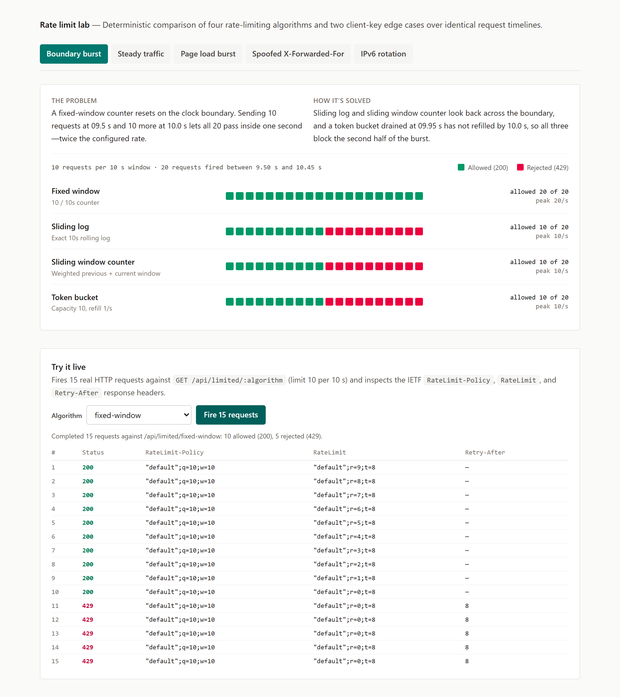
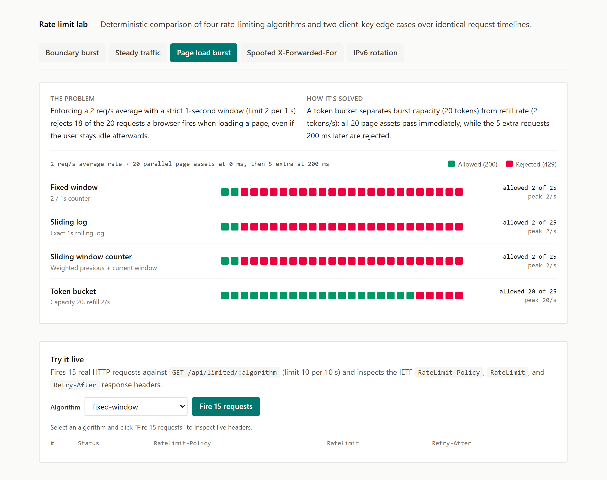
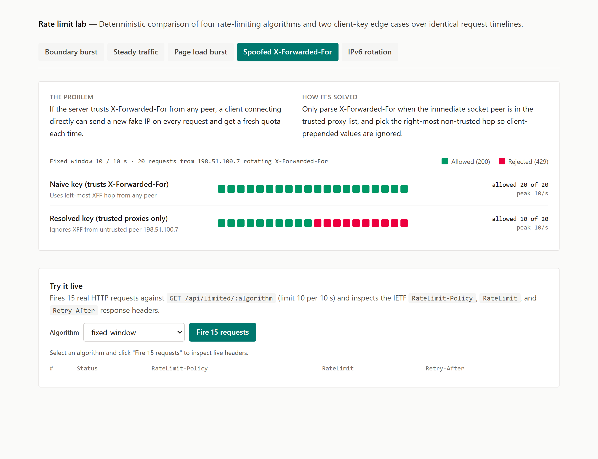
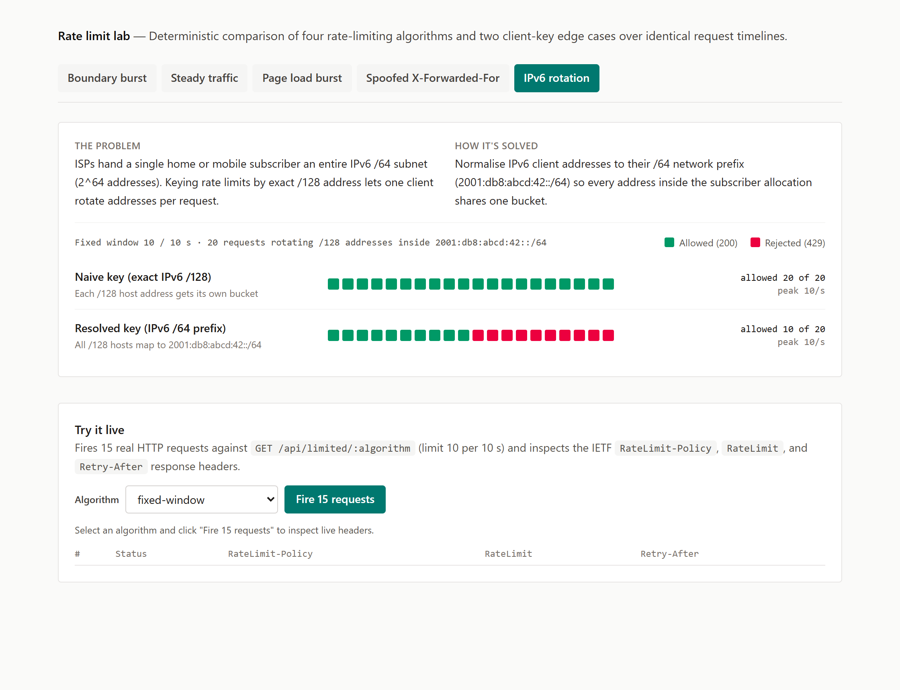

# Rate Limit Lab

Four classic HTTP rate-limiting algorithms behind a single TypeScript interface, a Hono middleware that emits standard IETF rate-limit headers, and a deterministic simulator that replays request bursts against each algorithm side by side.



---

## Quick Start

### Docker (recommended)

```bash
docker compose up -d --build
```

Open `http://localhost:3000` in your browser, or test the live endpoint with `curl`:

```bash
curl -i http://localhost:3000/api/limited/fixed-window
```

Stop the container with:

```bash
docker compose down
```

### Local Node.js (Node 22 LTS)

```bash
npm ci
npm run build
npm start
```

For development with hot reload on the backend:

```bash
npm run dev
```

---

## The Problem: Eight Edge Cases That Break Naive Rate Limiters

A naive "counter per IP per minute" rate limiter fails under predictable production conditions. Every edge case below is reproduced in the simulator or covered by a dedicated unit test:

| #   | Edge case                         | What goes wrong in a naive limiter                                                                                                                              | How this project handles it                                                                                                                                                                                                 | Test coverage                                                                                                                  |
| --- | --------------------------------- | --------------------------------------------------------------------------------------------------------------------------------------------------------------- | --------------------------------------------------------------------------------------------------------------------------------------------------------------------------------------------------------------------------- | ------------------------------------------------------------------------------------------------------------------------------ |
| 1   | **Window boundary burst**         | A fixed window of `100/min` allows 100 requests at `00:59` and 100 more at `01:00`—**200 requests in two seconds**.                                             | Reproduced in `FixedWindowLimiter`; eliminated exactly by `SlidingLogLimiter` and approximately by `SlidingWindowCounterLimiter`.                                                                                           | `test/core/FixedWindowLimiter.test.ts`, `test/core/SlidingLogLimiter.test.ts`, `test/core/SlidingWindowCounterLimiter.test.ts` |
| 2   | **Memory per client**             | Logging every timestamp per client grows with traffic.                                                                                                          | `SlidingLogLimiter` only records **allowed** units (capping per-key memory at `O(limit)` even under a flood) and prunes expired timestamps on every call; `SlidingWindowCounterLimiter` uses two integers per key (`O(1)`). | `test/core/SlidingLogLimiter.test.ts`, `test/core/SlidingWindowCounterLimiter.test.ts`                                         |
| 3   | **Bursty but legitimate clients** | A strict `2 req/s` window rejects 18 of 20 requests when a browser loads a page's assets in parallel, even if the user is idle afterwards.                      | `TokenBucketLimiter` separates burst `capacity` from sustained `refillPerSecond`, using integer milli-tokens with sub-millisecond remainder carried forward so no refill is lost to float drift.                            | `test/core/TokenBucketLimiter.test.ts`, `test/simulator/runScenario.test.ts`                                                   |
| 4   | **Wall-clock jumps (NTP)**        | Computing windows from `Date.now()` resets quotas early or locks clients out when the system clock steps backward or forward.                                   | All limiters read an injectable `Clock` backed by monotonic `performance.now()` (`MonotonicClock`) in production and `ManualClock` in tests and simulations.                                                                | `test/core/Clock.test.ts`                                                                                                      |
| 5   | **Spoofed `X-Forwarded-For`**     | Trusting `X-Forwarded-For` unconditionally lets any client send a different fake IP on every request and bypass the limiter.                                    | `createClientKeyResolver` ignores `X-Forwarded-For` unless the immediate TCP peer is in `trustedProxies`, then walks the header right-to-left and picks the **right-most non-trusted hop**.                                 | `test/http/clientKey.test.ts`                                                                                                  |
| 6   | **IPv6 address rotation**         | ISPs allocate a full `/64` subnet ($2^{64}$ addresses) to a single subscriber; keying by `/128` host address lets one client rotate addresses on every request. | `ipToClientKey` normalises IPv6 addresses to their `/64` network prefix (`2001:db8:abcd:42::/64`) and normalises IPv4-mapped IPv6 (`::ffff:192.0.2.1`) to IPv4.                                                             | `test/http/clientKey.test.ts`                                                                                                  |
| 7   | **Uninformative `429` responses** | Rejecting without headers causes clients to retry blindly in a tight loop, amplifying load.                                                                     | The Hono middleware emits structured `RateLimit-Policy` and `RateLimit` headers (`draft-ietf-httpapi-ratelimit-headers-09`) on every response, plus `Retry-After` (delta-seconds) and a JSON body on `429`.                 | `test/http/rateLimit.test.ts`                                                                                                  |
| 8   | **Unbounded key map**             | A `Map<string, State>` that never evicts idle keys leaks memory when an attacker rotates source keys.                                                           | `KeyStore` runs amortised sweeps that drop keys only **after** their limiter state is fully restored, and enforces a hard `maxKeys` cap (evicting expired keys first, then least-recently-used).                            | `test/core/KeyStore.test.ts`                                                                                                   |

---

## Algorithm Comparison

| Algorithm                                                  | State per key                                     | Rolling-window accuracy                                                 | Boundary burst                                                                                           | Best suited for                                                                                 |
| ---------------------------------------------------------- | ------------------------------------------------- | ----------------------------------------------------------------------- | -------------------------------------------------------------------------------------------------------- | ----------------------------------------------------------------------------------------------- |
| **Fixed window** (`FixedWindowLimiter`)                    | 2 integers (`windowStart`, `count`)               | Exact per aligned window; **up to $2\times$ limit** across a boundary   | Allows $2\times$ limit across the boundary                                                               | Coarse quotas (hourly/daily billing tiers) where a brief $2\times$ boundary spike is acceptable |
| **Sliding log** (`SlidingLogLimiter`)                      | Up to `limit` timestamps (`O(limit)`)             | **Exact** across every rolling window (`<= limit`)                      | Prevented ($1\times$ limit)                                                                              | Strict low-volume endpoints (login, password reset, OTP) where exactness matters more than RAM  |
| **Sliding window counter** (`SlidingWindowCounterLimiter`) | 3 integers (`windowStart`, `previous`, `current`) | **Approximate** (assumes previous window traffic was uniform)           | Classic boundary burst blocked; adversarial timing can still approach $< 2\times$ limit (see note below) | General API rate limiting: near-sliding behaviour at fixed-window memory cost                   |
| **Token bucket** (`TokenBucketLimiter`)                    | 2 integers (`milliTokens`, `lastRefill`)          | Enforces long-run average `refillPerSecond` with burst up to `capacity` | Allows bursts up to `capacity`, then throttles to `refillPerSecond`                                      | User-facing web and mobile APIs where page loads arrive in short bursts                         |

### Honest note on the Sliding Window Counter approximation

`SlidingWindowCounterLimiter` estimates the active count in the rolling window as:

$$\text{estimate} = \text{previous} \times \frac{\text{windowMs} - \text{elapsedInCurrentWindow}}{\text{windowMs}} + \text{current}$$

Under steady traffic or a burst right at the boundary, this stays tightly near `limit`. However, because it assumes the previous window's requests were spread evenly, an adversarial pattern that packs all `limit` requests into the **final millisecond** of window 0 and then spreads requests across window 1 as the weight decays can pass up to $2 \times \text{limit} - 1$ requests inside a single rolling window (`test/core/SlidingWindowCounterLimiter.test.ts`). When an exact rolling bound is required, use `SlidingLogLimiter`.

### Honest note on `KeyStore` size cap and LRU eviction

`KeyStore` never evicts an idle key while its window or bucket is still recovering—doing so would forgive the client's spent quota early. When `maxKeys` is reached and a sweep finds no expired keys, the store evicts the **least-recently-used** key to keep memory bounded. An evicted key receives a fresh quota if it returns before its old window would have ended; grouping IPv6 clients by `/64` (`clientKey.ts`) makes exhausting `maxKeys` require distinct `/64` networks or IPv4 addresses rather than free `/128` host rotation.

---

## Scenario Simulator

The web UI and `POST /api/simulate` replay five deterministic scenarios using `ManualClock`:

### 1. Boundary burst vs. Steady traffic vs. Page load burst



### 2. Client key resolution (`X-Forwarded-For` spoofing & IPv6 `/64` grouping)





---

## HTTP API

| Method & Path                 | Description                                                                                                                                                                                                                      |
| ----------------------------- | -------------------------------------------------------------------------------------------------------------------------------------------------------------------------------------------------------------------------------- |
| `GET /api/health`             | Returns `200 OK` with `{"status":"ok"}`.                                                                                                                                                                                         |
| `GET /api/limited/:algorithm` | Enforces a live `10 requests / 10 s` limit using `fixed-window`, `sliding-log`, `sliding-window-counter`, or `token-bucket`.                                                                                                     |
| `POST /api/simulate`          | Runs a deterministic simulation. Body: `{"scenario":"boundary-burst"}` (one of `boundary-burst`, `steady-traffic`, `page-load-burst`, `spoofed-xff`, `ipv6-rotation`) or `{"timeline":[0,100,200],"limit":10,"windowMs":10000}`. |

Example `429 Too Many Requests` response from `GET /api/limited/fixed-window`:

```http
HTTP/1.1 429 Too Many Requests
RateLimit-Policy: "default";q=10;w=10
RateLimit: "default";r=0;t=8
Retry-After: 8
Content-Type: application/json

{"error":"rate_limit_exceeded","algorithm":"fixed-window","limit":10,"remaining":0,"resetMs":7420,"retryAfterMs":7420,"retryAfterSeconds":8}
```

---

## Running Tests & Checks

```bash
npm test          # Vitest unit and HTTP integration suite
npm run typecheck # TypeScript strict check (backend + web)
npm run lint      # ESLint 9 flat config
```

---

## Scope & Limitations

- **Single-process, in-memory state:** This project runs in one Node.js process with an in-memory `KeyStore`. In a horizontally scaled deployment behind a load balancer, each Node instance would maintain its own counters unless state is moved to a shared store (typically Redis using single-round-trip atomic Lua scripts / Redis Functions so read-modify-write steps cannot race).
- **Local educational & diagnostic tool:** Dependency versions are locked to their autumn 2025 releases for reproducible builds; do not expose this container directly to the public internet without a reverse proxy.

## License

[MIT](LICENSE)
